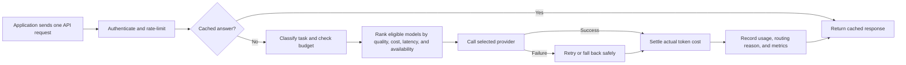

# LLM Gateway: Professor Project Brief

## The project in one sentence

I am building a secure control layer between applications and several large
language-model providers that chooses an appropriate model, limits traffic and
spending, survives provider failures, and explains every routing and cost
decision through a web portal and operational dashboards.

## The problem it solves

Without a gateway, an application is tightly coupled to one provider. Teams
must duplicate authentication, retry, budget, logging, and cost logic, and a
provider outage can stop the application. This project gives applications one
stable API while the gateway handles those cross-provider concerns centrally.

## What happens to one request

The gateway reserves a conservative estimated cost before a paid request. Once
the provider returns actual input and output token counts, it replaces that
reservation with the calculated cost. Provider invoices remain the financial
source of truth; the gateway's calculation is for routing and budget control.

## Main technical components

| Component | Responsibility |
| --- | --- |
| FastAPI gateway | OpenAI-compatible API, authentication, request validation, routing, and fallback |
| PostgreSQL | Organizations, identities, budgets, usage, routing evidence, and immutable audit metadata |
| Redis | Rate-limit counters and customer-isolated response caching |
| Intelligent router | Task classification and evidence-based model ranking |
| Customer portal | Keys, teams, budgets, usage, playground, and routing explanations |
| Admin control plane | Model catalog and independently reviewed pricing proposals |
| Prometheus and Grafana | Technical metrics, alerts, latency, errors, cost drift, and routing behavior |
| Docker Compose | Reproducible local environment for the gateway and dependencies |

## How model selection works

The customer chooses a goal: balanced, lowest cost, lowest latency, or highest
quality. The gateway first removes models that are unavailable, disallowed,
incapable of the estimated difficulty, or outside the request's cost ceiling.
It then scores the remaining models using versioned evaluation evidence plus
configured cost and latency estimates. The response records the selected model,
policy and score versions, task classification, and human-readable reasons.

This is deliberately measurable and rule-based. The long-term goal is not to
claim that one brand is always best, but to maintain repeatable task-specific
evaluations for coding, reasoning, summarization, extraction, and general chat.

## Security and reliability choices

- API keys are shown once and stored as digests, not plaintext.
- Cache entries, rate limits, budgets, and usage are isolated by customer.
- Provider secrets, prompts, and responses are excluded from metrics and audit
  records.
- Paid providers are disabled by default, so local validation uses a free mock.
- Provider calls have gateway-controlled timeouts, retries, circuit breakers,
  and ordered fallback.
- Pricing changes use a two-person workflow: one platform operator proposes a
  sourced change and another approves or rejects it. Approval is audited and
  does not silently mutate the live environment.
- Intelligent routing supports shadow mode, canary cohorts, version pins, and an
  immediate baseline rollback.

## What is working now

- Multi-provider chat gateway with OpenAI, Anthropic, local, and mock adapters.
- Authentication, customer rate limits, cache isolation, budgets, cost
  settlement, retries, fallback, and circuit breakers.
- Task-aware routing, evaluation score sets, explanations, shadow mode, canary
  controls, Prometheus metrics, Grafana dashboards, and rollback procedures.
- A browser portal for organization accounts, teams, keys, service accounts,
  usage, budgets, routing preferences, and safe request testing.
- A platform-operator model catalog. The reviewed pricing workflow is the
  current development checkpoint.

The portal currently runs locally; public staging and production deployment are
planned after the administrator control plane is complete.

## A short demonstration

1. Open the portal and show the monthly cost, token, request, and budget cards.
2. Use the playground to preview a route without calling a paid provider.
3. Run a mock request and point out the selected model, cost, tokens, attempts,
   task classification, and routing reasons.
4. Show the model catalog and explain that its costs are configured estimates.
5. Show Grafana to separate customer-facing product views from operator
   monitoring.
6. Explain how disabling intelligent routing immediately returns traffic to the
   Version 1 baseline router.

## Thirty-second explanation

> My project is an LLM gateway: an application sends one request instead of
> integrating separately with every AI provider. The gateway authenticates the
> customer, prevents abuse and overspending, classifies the task, and chooses an
> eligible model using measured quality, cost, speed, and availability. If that
> provider fails, it safely retries or falls back. It then records token usage,
> estimated provider cost, and why the model was selected. Customers see their
> usage in a web portal, while operators use Grafana and a secured admin control
> plane. The design also supports shadow tests, canary rollout, and instant
> rollback so smarter routing can be introduced safely.

## Honest limitations and next work

- Provider billing is not yet customer invoicing; customer payments and markup
  belong to a later billing milestone.
- Quality scores need ongoing real-provider evaluations to stay current.
- Approved pricing proposals are reviewed deployment inputs; automated,
  rollback-safe activation is a later administrator-control checkpoint.
- The service needs staging validation and production hosting before it is a
  public SaaS product.
